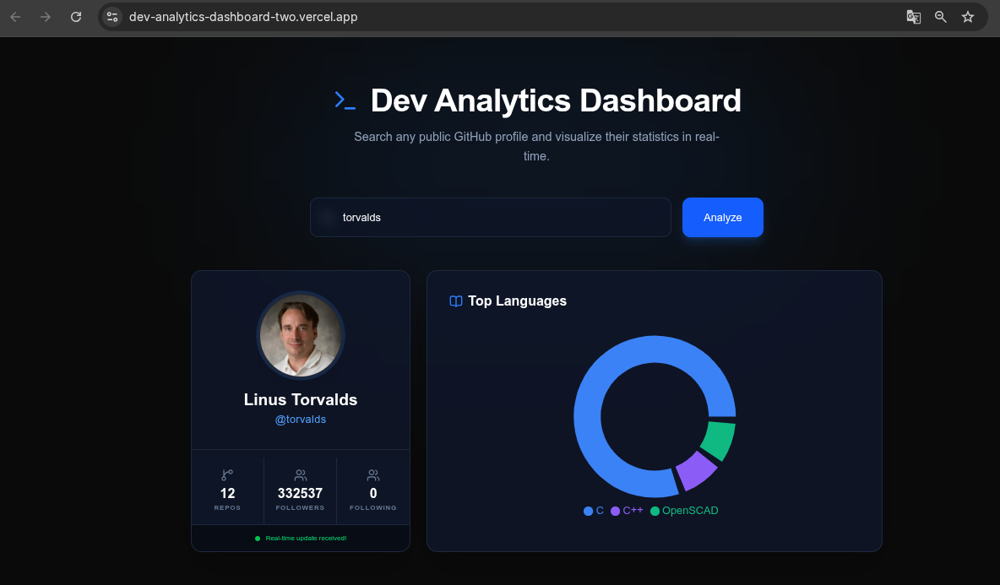

# Dev Analytics Dashboard

A real-time analytics dashboard that visualizes GitHub profile statistics. Built with Django, Next.js, and WebSockets.

## Live Demo

- **Frontend:** [https://dev-analytics-dashboard-two.vercel.app](https://dev-analytics-dashboard-two.vercel.app)
- **API Documentation (Swagger):** [https://dev-analytics-dashboard-v4d7.onrender.com/api/docs](https://dev-analytics-dashboard-v4d7.onrender.com/api/docs)

## Tech Stack

- **Backend:** Django, Django Ninja, Django Channels (WebSockets)
- **Frontend:** Next.js (App Router), React, Tailwind CSS, Recharts
- **Deployment:** Render (Backend), Vercel (Frontend)

## The Problem

Developers and technical recruiters often need a quick, visual way to assess a GitHub profile's activity, language distribution, and repository statistics. This dashboard consumes the public GitHub API, processes the data on the server, and presents it in a clean, real-time interface.

## Engineering Decisions

- **WebSockets over Polling:** Implemented Django Channels and WebSockets to push real-time updates to the frontend. This avoids the overhead of constant HTTP polling and ensures the client always displays fresh data with minimal server load.
- **Caching Strategy:** GitHub's public API has strict rate limits (60 requests/hour for unauthenticated users). A Django caching layer was implemented to store fetched profile data for 15 minutes. This prevents the application from breaking under heavy traffic and avoids rate-limit bans.
- **Data Processing:** The raw GitHub API response is processed and aggregated on the server side before being sent to the frontend. This keeps the client lightweight and ensures complex data transformations are handled where they belong.

## Features

- Search for any public GitHub user.
- Visualize language distribution and repository statistics.
- Real-time updates via WebSockets.
- Responsive, dark-mode-first design.

## Screenshots



## Local Setup

Backend
```bash
cd backend
pip install -r requirements.txt
python manage.py migrate
python manage.py runserver

Frontend

cd frontend
npm install
npm run dev
